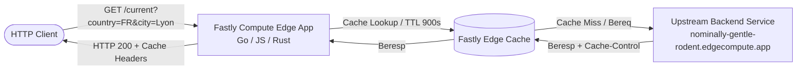

# Fastly Compute Edge Caching Tutorial: Consuming an Upstream Backend

Welcome to the Fastly Compute Edge Caching tutorial! In this hands-on workshop, you will learn how to build, test, and deploy a high-performance edge application using **Fastly Compute** in your language of choice: **Go**, **JavaScript**, or **Rust**.

---

## 🎯 Tutorial Overview & Objectives

In modern web architectures, edge computing enables you to run logic close to end users while minimizing latency and reducing load on origin servers. Fastly Compute runs WebAssembly (Wasm) binaries compiled from Go, JavaScript, Rust, and other languages with microsecond startup times.

In this tutorial, you will:
1. **Initialize a Fastly Compute project** from scratch with the Fastly CLI.
2. **Run and test locally** using `fastly compute serve` and local mock/real backend configurations.
3. **Deploy your service to Fastly's edge network** using `fastly compute deploy`.
4. **Integrate an upstream Fastly Compute backend API** (`https://nominally-gentle-rodent.edgecompute.app/`).
5. **Implement edge caching and cache override policies** using the Fastly SDK (TTLs, Stale-While-Revalidate, and custom headers).

---

## 🏗️ Architecture



### Upstream Backend Specification
Our upstream backend is a weather and geocoding service running on Fastly Compute at:
`https://nominally-gentle-rodent.edgecompute.app/`

It provides the following endpoints:
- `GET /`: Landing and help documentation.
- `GET /current?country=FR&city=Lyon`: Current weather observation for the given city (defaults to Lyon, France if omitted).
- `GET /next?country=FR&city=Lyon`: 24-hour hourly forecast.
- `GET /city?country=FR&city=Lyon`: Metadata and GPS coordinates cached in Fastly KV Store.

---

## 📚 Official Fastly Documentation & SDK References

Before diving in, bookmark these essential Fastly resources:
- [Fastly Compute Documentation](https://www.fastly.com/documentation/guides/compute/)
- [Fastly Caching Concepts](https://www.fastly.com/documentation/guides/concepts/edge-state/cache/)
- [Fastly Backend Configuration](https://www.fastly.com/documentation/guides/compute/backends/)
- [Fastly CLI Reference](https://www.fastly.com/documentation/reference/tools/cli/)
- [Rust SDK (`fastly`) Documentation](https://docs.rs/fastly/latest/fastly/)
- [Go SDK (`compute-sdk-go`) Documentation](https://pkg.go.dev/github.com/fastly/compute-sdk-go)
- [JavaScript SDK (`@fastly/js-compute`) Documentation](https://js-compute-reference-docs.edgecompute.app/)

---

## 📁 Repository Structure & Branch Model

This repository is organized into three standalone language workspaces:

```
fastly-apero-tech/
├── README.md                      # Main language-agnostic tutorial guide (this file)
├── go/                            # Go implementation workspace
│   ├── README.md                  # Go step-by-step tutorial
│   ├── fastly.toml                # Fastly manifest & local server configuration
│   ├── go.mod                     # Go module & dependencies
│   └── main.go                    # Application code
├── js/                            # JavaScript implementation workspace
│   ├── README.md                  # JavaScript step-by-step tutorial
│   ├── fastly.toml                # Fastly manifest & local server configuration
│   ├── package.json               # Node.js dependencies & build script
│   └── src/
│       └── index.js               # Application code
└── rust/                          # Rust implementation workspace
    ├── README.md                  # Rust step-by-step tutorial
    ├── Cargo.toml                 # Rust dependencies
    ├── fastly.toml                # Fastly manifest & local server configuration
    ├── rust-toolchain.toml        # Rust WASI toolchain configuration
    └── src/
        └── main.rs                # Application code
```

### Branch Strategy
- **`main`**: Starter templates with complete documentation and basic HTTP hello-world starter code.
- **`solution-backend`**: Full reference solution implementing backend proxying to `https://nominally-gentle-rodent.edgecompute.app/` with TTL and Stale-While-Revalidate caching.

---

## 🚀 Step-by-Step Tutorial

### Step 1: Install the Fastly CLI & Configure Authentication

1. **Install the Fastly CLI**:
   - **macOS (Homebrew)**: `brew install fastly/tap/fastly`
   - **Linux**: `curl -fsSL https://api.github.com/repos/fastly/cli/releases/latest | grep "browser_download_url.*linux_amd64.tar.gz" | cut -d : -f 2,3 | tr -d \" | wget -qi - && tar -xzf fastly_*_linux_amd64.tar.gz && sudo mv fastly /usr/local/bin/`
   - **Windows (Scoop / Chocolatey)**: `scoop install fastly` or `choco install fastly-cli`
   - See [Fastly CLI Installation Guide](https://www.fastly.com/documentation/reference/tools/cli/#installing).

2. **Authenticate with Fastly**:
   ```bash
   fastly profile create default
   ```
   Paste your API token when prompted (generate one in [Fastly Web Console](https://manage.fastly.com/) under **Account > API tokens** with Superuser or Engineer access).

3. **Verify Authentication**:
   ```bash
   fastly whoami
   ```

---

### Step 2: Choose Your Language & Setup Toolchain

#### The easy way: Navigate to your language of choice:

- 👉 [Go Tutorial & Guide](./go/README.md) (requires Go 1.21+)
- 👉 [JavaScript Tutorial & Guide](./js/README.md) (requires Node.js 18+)
- 👉 [Rust Tutorial & Guide](./rust/README.md) (requires `rustup target add wasm32-wasip1`)

### A less easy way: init the project with the Fastly Compute CLI

Create a new directory for your project and then

```bash
fastly compute init
```

1. Enter your service name and description when prompted.
2. Select your preferred language: **Rust**, **Go**, or **JavaScript**.
3. Choose the **Default** starter kit.

And can still use the specific README.md by language


---

### Step 3: Local Development with `fastly compute serve`

Fastly Compute allows you to run and debug services locally using Viceroy (the local WebAssembly execution runtime).

1. Change directory to your chosen language folder:
   ```bash
   cd go    # or cd js, or cd rust
   ```

2. Start the local server with hot-reloading:
   ```bash
   fastly compute serve --watch
   ```

3. Open `http://localhost:7676` in your browser or test with curl:
   ```bash
   curl -i http://localhost:7676/
   ```

---

### Step 4: Connecting the Upstream Backend in `fastly.toml`

When running locally, Fastly needs to know where named backends route to. In `fastly.toml`, add:

```toml
manifest_version = 3
name = "fastly-apero-edge"
language = "rust" # or "go", "javascript"

[local_server.backends.backend_api]
url = "https://nominally-gentle-rodent.edgecompute.app"
```

In production, Fastly connects to backends created in your service configuration (via CLI or UI). When deploying, the Fastly CLI will prompt you to create the `backend_api` backend pointing to `https://nominally-gentle-rodent.edgecompute.app:443`.

---

### Step 5: Caching Mechanisms on Fastly Compute

Fastly provides two main approaches to caching:

#### 1. Origin-Driven Caching (Default)
When you forward a request to an upstream origin, Fastly automatically respects standard HTTP caching headers in the response:
- `Cache-Control: public, max-age=900, stale-while-revalidate=3600`
- `Surrogate-Control: max-age=1800`

#### 2. Programmatic Cache Overrides (Fastly SDK)
You **can override** origin cache behavior directly in your edge code:
- **Time-to-Live (TTL)**: How long Fastly caches the response at the edge.
- **Stale-While-Revalidate (SWR)**: How long Fastly serves a stale cached copy while asynchronously refreshing from the backend in the background.
- **Surrogate Keys**: Tagging cache entries for instant, targeted purging.

**note**: I don't recommend overriding the cache header parameters: it's not the behavior provided by the emitter.

#### Language-Specific Cache Overrides:

- **Go SDK (`compute-sdk-go`)**:
  ```go
  bereq.CacheOptions = fsthttp.CacheOptions{
      TTL:                  900,
      StaleWhileRevalidate: 3600,
  }
  resp, err := bereq.Send(ctx, "backend_api")
  
  ```

- **JavaScript SDK (`@fastly/js-compute`)**:
  ```javascript
  import { CacheOverride } from "fastly:cache-override";

  const cacheOverride = new CacheOverride("override", {
      ttl: 900,
      swr: 3600,
  });
  const res = await fetch(url, { backend: "backend_api", cacheOverride });
  ```

- **Rust SDK (`fastly`)**:
  ```rust
  let mut bereq = Request::get(url)
      .with_header("Host", "nominally-gentle-rodent.edgecompute.app")
      .with_ttl(900)
      .with_stale_while_revalidate(3600);
  let beresp = bereq.send("backend_api")?;
  ```

The fastly readthrough cache(the basic http cache) deal with a lot things.
If you want to add some special case with this cache like using a caching response on 50x response, 
you can use in the CacheOption the [AfterSend](https://www.fastly.com/documentation/guides/concepts/cache/#controlling-cache-behavior-based-on-backend-response) to change the behavior.


---

### Step 6: Deploying to Fastly

Once your application logic is implemented and tested locally:

```bash
fastly compute deploy
```

During the initial deployment:
1. Fastly CLI will prompt: `Create new service? [y/N]: y`
2. Name the service: `fastly-apero-tutorial`
3. Backend configuration prompt:
   - Backend name: `backend_api`
   - Host/Domain: `nominally-gentle-rodent.edgecompute.app`
   - Port: `443`
   - Use TLS: `yes`

Upon deployment, Fastly will display your live edge URL (e.g. `https://your-service-xyz.edgecompute.app`).

---

## ⚙️ Other useful commands

👉 [Fastly CLI documentation](https://www.fastly.com/documentation/reference/cli/)


For **create**, update, delete, list, ... the backend (of a service)
```bash
fastly service backend ...
```

For **create**, update, delete, describe, list, **purge** ... a service (a compute is a type of service)
```bash
fastly service ...
```

For **create**, delete, describe list the kv store
```bash
fastly kv-store ...
```

For **create**, update, delete, describe, list the link between a service and resource like a storage (kv store, config store, ...)
```bash
fastly service resource-link  ...
```

---

## 🔍 Checking the Solution

If you want to review the complete working solution across all three languages:

```bash
git checkout solution-backend
```

Happy coding with Fastly Compute! 🚀
